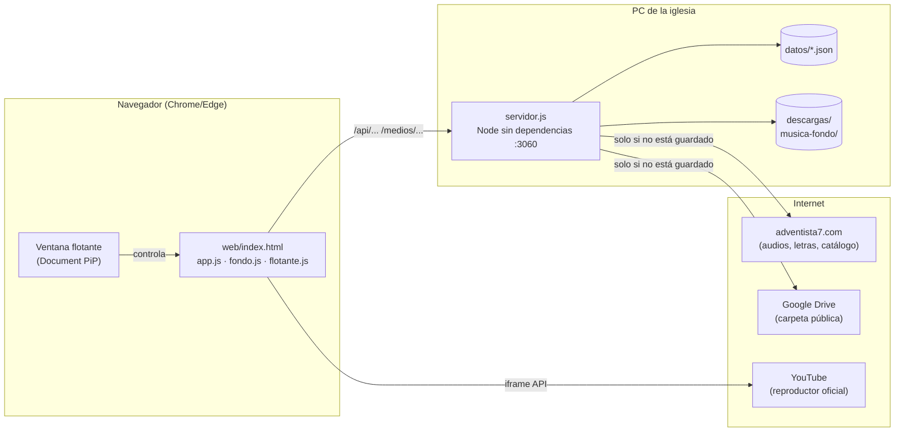

# Himnario offline

App web para la iglesia: los 613 himnos del Himnario Adventista con audio (cantado e
instrumental), letra sincronizada con el audio, meditación bíblica por himno, favoritos,
música desde Google Drive, videos de YouTube, música de fondo y ventana flotante.
Funciona **sin internet** para todo lo que ya se guardó en la PC.

Developed by Marco Antonio Mamani

---

## 1. Puesta en marcha

### Qué instalar

| Requisito | Para qué | Notas |
|---|---|---|
| **Node.js 20 o superior** | Ejecuta el servidor | Única instalación. Descarga: https://nodejs.org (versión LTS). Comprobar con `node -v` |
| **Google Chrome o Microsoft Edge** | Usar la app | Firefox funciona, salvo la ventana flotante (⧉) |
| **Internet la primera vez** | Bajar la lista de himnos y cada himno la primera vez que se abre | Después, lo guardado funciona sin conexión |

**No hace falta `npm install`.** El proyecto no tiene dependencias: usa solo módulos que
vienen con Node (`http`, `fs`, `path`, `fetch`).

### Cómo levantarlo

**Opción A (recomendada): doble clic en `iniciar.bat`.**
Se abre una ventana negra titulada "Himnario - Servidor". Déjala abierta (puede estar
minimizada); si la cierras, la app deja de funcionar.

**Opción B: desde una consola** (Git Bash o CMD), dentro de la carpeta del proyecto:

```bash
node servidor.js
```

o, lo mismo:

```bash
npm start
```

Cuando arranca muestra:

```
Himnario listo: 613 himnos
Abre http://localhost:3060 en esta PC
```

### Cómo abrirlo

- **En la PC:** http://localhost:3060
- **En el celular** (misma red WiFi): `http://IP-de-la-PC:3060`. La IP se ve con `ipconfig`
  en CMD ("Dirección IPv4"). El firewall de Windows debe permitir conexiones entrantes a
  Node; en laptops corporativas normalmente está bloqueado.

### Cambiar el puerto

Por defecto usa el **3060**. Para otro (CMD):

```bat
set PUERTO=3070 && node servidor.js
```

### Primera vez

Al primer inicio, el servidor baja la lista de los 613 himnos (con títulos, temas y tiempos
de la letra) y la guarda en `datos/catalogo.json`. **Necesita internet**; si no hay, avisa y
se cierra. A partir de ahí arranca sin conexión.

---

## 2. Qué hace (guía de uso)

| Sección | Qué ofrece |
|---|---|
| **Himnos** (pantalla inicial) | Buscador por número (Enter abre directo) o título, filtro por tema, pestañas ♥ Favoritos y ⬇ Sin internet |
| **Dentro de un himno** | Audio cantado/instrumental, letra en miniaturas (la que suena se resalta), favorito ♥, "Guardar sin internet", meditación con citas y texto bíblico, ✎ para escribir tu propia meditación o pegar la letra en texto |
| **🎬 Presentación** | Letra en grande, una página a la vez, cambiando en el segundo exacto del audio. ⛶ pantalla completa para el proyector. Teclas: espacio, ←/→, Esc |
| **♫ Música** | Audios de una carpeta pública de Google Drive (y subcarpetas). ⏮ ⏭, aleatorio, buscador, "Guardar todo sin internet", agregar más carpetas |
| **▶ Videos** | Enlaces de YouTube (videos o listas). Muestra todos los videos de una lista. Los que YouTube no permite ver quedan en gris con el motivo y se saltan solos |
| **🌙 Música de fondo** | Suena suave cuando nada más suena y se apaga sola al reproducir algo. Pistas: *LlamadoSermon* (prioridad), *Ambiente suave* y *Sublime gracia* (generadas por la app), lo que haya en `musica-fondo/` y canciones de Drive marcadas con 🌙 |
| **Reproductor flotante** | Al salir de una pantalla, lo que suena sigue en un mini reproductor (audio) o en una esquina (video), con barra para adelantar |
| **⧉ Ventana flotante** | Ventana "siempre encima" que se puede mover a cualquier parte, incluso con Chrome minimizado. Muestra la letra del himno o el video. Solo Chrome/Edge |

Otros detalles: nunca suenan dos cosas a la vez, las teclas multimedia del teclado funcionan
(incluido adelantar desde el panel multimedia de Windows) y, mientras algo suena con la
página visible, se pide al sistema que no suspenda la pantalla.

### Agregar contenido sin tocar código

| Quiero… | Cómo |
|---|---|
| Otra música de fondo | Copiar el mp3/m4a/mp4 a `musica-fondo/` y recargar la página |
| Más música en ♫ Música | Subirla a la carpeta de Drive y tocar ⟳ |
| Otra carpeta de Drive | ♫ Música → "Carpetas de Google Drive" → pegar el enlace (debe ser pública) |
| Videos de YouTube | ▶ Videos → pegar enlaces → Agregar |
| La meditación de un himno | En el himno, ✎ "Escribir mi propia meditación" |
| Meditaciones para muchos himnos | Editar `datos/meditaciones-himnos.json` (ver formato en la sección 4) |

---

## 3. Cómo está hecho

### Visión general



- **Servidor (`servidor.js`):** un solo archivo con `http` de Node. Sirve la interfaz, una API
  JSON y los archivos de audio/imagen. Cuando le piden algo que no tiene guardado, lo baja
  de internet **una vez**, lo guarda en disco y desde entonces lo sirve local
  ("descarga bajo demanda").
- **Interfaz (`web/`):** HTML, CSS y JavaScript sin frameworks ni CDNs (para funcionar sin
  internet). Estilo Material 3 hecho a mano, con modo claro y oscuro automático.

### Estructura de carpetas

```
Himnario/
├── iniciar.bat              Arranque con doble clic
├── package.json             Solo metadatos y el script "start" (sin dependencias)
├── servidor.js              Servidor HTTP + API + descargas bajo demanda
├── web/                     Interfaz (se sirve tal cual, sin compilar)
│   ├── index.html           Todas las pantallas y diálogos
│   ├── estilos.css          Estilos (tokens de color claro/oscuro)
│   ├── app.js               Lógica principal (ver tabla abajo)
│   ├── fondo.js             Música de fondo (incluye el sintetizador)
│   ├── flotante.js          Ventana flotante "siempre encima"
│   ├── video-flotante.html  Página auxiliar del reproductor de YouTube en la ventana flotante
│   ├── manifest.webmanifest Para "instalar" como app
│   └── icono.svg
├── datos/                   Información de la app (JSON)
├── descargas/               Audios y letras guardados (se crea sola)
│   ├── 001/ … 613/          cantado.mp3, instrumental.mp3, letra-01.jpg …
│   └── musica/              Canciones de Drive guardadas (por id de archivo)
└── musica-fondo/            Pistas de fondo propias (se copian a mano)
```

### Archivos de `datos/`

| Archivo | Contenido | Quién lo escribe |
|---|---|---|
| `catalogo.json` | 613 himnos: número, título, páginas de letra, tema, `tiempos` (ms en que cambia cada página) | El servidor, al primer inicio o con ⟳ |
| `biblia-rv1909.json` | Biblia Reina-Valera 1909 completa (eBible.org, dominio público) | Viene con el proyecto |
| `meditaciones.json` | Meditaciones por tema (5–7 por cada uno de los 9 temas) | Viene con el proyecto (editable) |
| `meditaciones-himnos.json` | Meditaciones escritas para un himno específico (clave = número de himno) | A mano |
| `mis-meditaciones.json` | Meditaciones escritas desde la app con ✎ | La app |
| `mis-letras.json` | Letras pegadas en texto desde la app | La app |
| `favoritos.json` | Números de himnos favoritos | La app |
| `videos.json` | Videos y listas de YouTube agregados | La app |
| `youtube-titulos.json` | Título y estado (disponible o no) de cada video de YouTube | El servidor (caché) |
| `musica.json` | Carpetas de Drive configuradas | La app |
| `musica-cache.json` | Última lista conocida de cada carpeta de Drive (para usarla sin internet) | El servidor (caché) |

Todos se escriben primero en un archivo temporal y luego se renombran, para que un corte de
luz no los deje a medias.

### API del servidor

| Método y ruta | Qué hace |
|---|---|
| `GET /api/himnos` | Lista de himnos con favorito y estado de descarga |
| `GET /api/himnos/:n` | Un himno completo: datos, tiempos, meditación (con texto bíblico), letra en texto |
| `POST /api/himnos/:n/favorito` | Marca o desmarca favorito |
| `POST /api/himnos/:n/descargar` | Guarda letra y audios para usar sin internet |
| `PUT /api/himnos/:n/meditacion` | Guarda (o borra) la meditación propia |
| `PUT /api/himnos/:n/letra` | Guarda (o borra) la letra en texto |
| `POST /api/catalogo/actualizar` | Vuelve a bajar el catálogo |
| `GET /api/musica` | Canciones de las carpetas de Drive |
| `POST /api/musica/carpetas` · `DELETE /api/musica/carpetas/:id` | Agregar o quitar carpeta |
| `POST /api/musica/guardar/:id` | Guarda una canción para usar sin internet |
| `GET /api/videos` · `POST /api/videos` · `DELETE /api/videos/:tipo/:id` | Lista de YouTube |
| `POST /api/videos/titulos` | Título y disponibilidad de varios videos (consulta oEmbed, con caché) |
| `POST /api/videos/no-disponible` | Registra que el reproductor no pudo con un video |
| `GET /api/fondo/pistas` | Archivos de `musica-fondo/` |
| `GET /medios/:n/cantado.mp3` · `instrumental.mp3` · `letra-NN.jpg` | Archivos de un himno (los baja la primera vez) |
| `GET /medios/musica/:id` | Canción de Drive (la primera vez la transmite mientras la guarda) |
| `GET /medios/fondo/:archivo` | Pista de `musica-fondo/` |

Los archivos de audio aceptan `Range`, por eso se puede adelantar. La interfaz se sirve con
`Cache-Control: no-cache` para que siempre se vea la última versión.

### Módulos de la interfaz (`web/app.js`)

| Sección | Responsabilidad |
|---|---|
| Reproductor global | **Un solo `<audio id="motor">`** para himnos y música; controles propios en cada pantalla; mini reproductor; coordinación para que nunca suenen dos cosas a la vez |
| Lista / Himno | Buscador, favoritos, descarga, letra, meditación |
| Presentación | Letra sincronizada: misma regla que el sitio de origen (página = 1 + tiempos menores que `segundo_redondeado·1000 + 1000`), revisada cada 100 ms |
| Videos | API oficial de YouTube (IFrame). El iframe nunca se mueve en el documento (moverlo lo recargaría): se coloca encima de un hueco o flota en una esquina |
| Videos no disponibles | Estado desde oEmbed (antes de reproducir) y desde los errores del reproductor (100 = no existe, 101/150 = no permite verse fuera de YouTube) |
| Música | Lista de Drive, cola, aleatorio |
| Suspensión | Wake Lock de pantalla mientras algo suena |

`fondo.js` genera "Ambiente suave" y "Sublime gracia" con Web Audio (osciladores, filtros,
reverberación por convolución); no usa archivos. `flotante.js` usa *Document
Picture-in-Picture*. Para mostrar un video en la ventana flotante carga
`video-flotante.html` dentro de ella, porque YouTube rechaza reproductores en páginas sin
dirección propia, y la ventana flotante lo es.

### Convenciones del código

- Todo en español: nombres, comentarios y mensajes.
- Sin dependencias ni pasos de compilación: se edita el archivo y se recarga la página
  (los cambios en `servidor.js` requieren reiniciarlo).
- Errores siempre manejados: si falta internet, la app avisa y sigue con lo que tiene guardado.
- Seguridad básica: las rutas de archivos se validan para no salir de sus carpetas, y los
  cuerpos JSON tienen tamaño máximo.

---

## 4. Formato de las meditaciones

`datos/meditaciones-himnos.json` (clave = número de himno **de esta app**):

```json
{
  "14": {
    "titulo": "Hasta aquí nos ayudó",
    "reflexion": "Texto propio de la reflexión…",
    "citas": [
      { "referencia": "1 Samuel 7:12", "nota": "Comentario breve" },
      { "referencia": "Lamentaciones 3:22-23", "nota": "…" }
    ]
  }
}
```

El texto del versículo **no se escribe**: la app lo busca solo en la Reina-Valera 1909 a partir
de la referencia. Formatos válidos: `Juan 3:16`, `Juan 14:16-18, 26`, `Salmo 23` (capítulo
completo).

Prioridad al mostrar: meditación escrita en la app (✎) → `meditaciones-himnos.json` →
una de su tema en `meditaciones.json`.

> **Ojo con la numeración:** otros sitios (por ejemplo himnario.net) usan una edición
> anterior del himnario con otra numeración. Para asignar una meditación, busca el himno
> **por título** en esta app.

---

## 5. Solución de problemas

| Síntoma | Causa y solución |
|---|---|
| "No se puede acceder a este sitio" | El servidor no está corriendo. Abre `iniciar.bat` y deja la ventana abierta |
| `EADDRINUSE: address already in use :::3060` | Ya hay un servidor en ese puerto (probablemente otra ventana del Himnario). Usa esa, ciérrala, o cambia el puerto con `PUERTO` |
| La página no responde a los clics o se ve rara tras una actualización | Versión vieja guardada en el navegador: **Ctrl+F5**. La app intenta detectarlo y recargarse sola |
| El servidor tarda en responder al iniciar | Normal unos segundos; espera y recarga |
| "No está guardado en la PC y no hay internet" | Ese himno o canción nunca se abrió con conexión. Ábrelo una vez con internet, o usa "Guardar sin internet" antes |
| El celular no abre la página | Firewall de la PC o redes WiFi distintas |
| La ventana flotante (⧉) no se abre | Solo funciona en Chrome o Edge de escritorio. Los navegadores integrados en otras apps no la soportan |
| Un video sale "No disponible" | El dueño no permite verlo fuera de YouTube, o fue borrado. La app lo marca y lo salta; se revisa de nuevo cada 7 días |
| PowerShell da "No se pudo iniciar CLR" | Problema de esa PC con PowerShell. Usa `iniciar.bat` o Git Bash/CMD |

---

## 6. Contenido y derechos

- **Audios y letras del himnario** (de adventista7.com): tienen derechos de autor. La app los
  muestra tal como los publica el sitio (las letras son sus imágenes) y los guarda solo para
  uso de la iglesia. **No los vuelvas a publicar.**
- **Biblia Reina-Valera 1909**: dominio público.
- **Meditaciones incluidas**: texto original escrito para esta app.
- **Sublime gracia y Ambiente suave**: generados por la app. La melodía "New Britain" (1829)
  es de dominio público y el arreglo es propio.
- **YouTube**: se usa su reproductor oficial; los videos necesitan internet y muestran lo que
  YouTube decida, incluida la publicidad.
- **Archivos de `musica-fondo/`**: los agrega la iglesia, que es responsable de tener permiso
  para usarlos.
